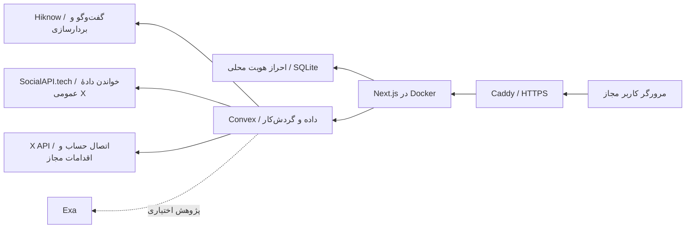

# مستند فنی و زیرساختی ReacherX — نسخهٔ خصوصی کشف فرصت در X/Twitter

**مبنای این سند:** شاخهٔ `codex/twitter-private-hiknow` در مخزن `KianJanbozorgi/reacher-x`، بررسی‌شده در ۱۷ مهر ۱۴۰۵. این سند وضعیت پیاده‌سازی را توضیح می‌دهد؛ تأیید کامل کارکرد محصول در مرورگر و محیط تولید هنوز انجام نشده است. برای دستورالعمل عملی واگذاری به مسئول سرور، [DEPLOYMENT_HANDOFF.md](../DEPLOYMENT_HANDOFF.md) را نیز بخوانید.

## ۱. هدف و دامنهٔ محصول

محصول برای تعداد محدودی کاربر مجاز، فرصت‌های بالقوه را از پست‌های عمومی X/Twitter پیدا می‌کند. کاربر پس از ورود، فضای کاری و توصیف مخاطب هدف را می‌سازد؛ سامانه عبارت‌های جست‌وجو را پیشنهاد می‌کند، پست‌ها را می‌گیرد، نامزدهای مناسب را ذخیره و ارزیابی می‌کند و در رابط کاربری نشان می‌دهد. برای برنامه‌ریزی ارتباط و برخی اقدام‌های اجتماعی نیز ایجنت و جریان تأیید انسانی وجود دارد.

ورود و ثبت‌نام با حساب محلی و نشست ذخیره‌شده در Docker انجام می‌شود؛ ثبت‌نام با نام، ایمیل و رمز عبور انجام می‌شود و بازیابی رمز فعلاً غیرفعال است. اطلاعات محصول، ایجنت‌ها، گردش‌کارها و داده‌ها در Convex قرار می‌گیرند. رابط وب با Next.js اجرا می‌شود و در استقرار پیشنهادی، Docker و Caddy آن را با HTTPS منتشر می‌کنند. رابط، راست‌به‌چپ است و فونت Vazirmatn را از خود پروژه بارگذاری می‌کند؛ **متن‌های رابط و پرامپت‌ها به‌طور کامل فارسی‌سازی نشده‌اند**.

Docker فقط بخش وب را میزبانی می‌کند؛ Convex سرویس مدیریت‌شدهٔ جداگانه است. PostgreSQL یا Redis محلی برای مسیر اصلی لازم نیست. کد این تقسیم کار در `Dockerfile`، `compose.yaml`، `compose.production.yaml`، `Caddyfile`، `app/` و `convex/` دیده می‌شود.

## ۲. اجزای معماری و داده

| جزء | مسئولیت | مرجع کد |
| --- | --- | --- |
| Next.js/React | صفحات، رندر، مسیریابی، اتصال به Convex، ورودی کاربر | `app/`، `features/`، `shared/` |
| احراز هویت محلی | ورود و ثبت‌نام با نام، ایمیل و رمز عبور و نشست محلی؛ بازیابی رمز فعلاً غیرفعال | `shared/lib/localAuth/`، `proxy.ts` |
| Convex | پایگاه داده، کوئری/جهش/اکشن، رویدادهای بلادرنگ، کران‌ها و گردش‌کارها | `convex/schema.ts`، `convex/crons.ts` |
| ایجنت و RAG | گفت‌وگوی راه‌اندازی، تحلیل، حافظه و برنامه‌ریزی تعامل | `convex/agents/`، `convex/agents/outreach/rag.ts` |
| SocialAPI.tech | جست‌وجوی پست و خواندن پروفایل، تایم‌لاین، رشته و رابطهٔ عمومی | `convex/lib/socialApiTech.ts`، `convex/integrations/twitter/` |
| X API | OAuth حساب متصل و اقدام‌هایی مانند پاسخ/پیام، بسته به مجوز و محدودیت X | `convex/x*`، `app/api/x/callback/route.ts` |
| Caddy | گواهی TLS و پراکسی معکوس به کانتینر وب | `Caddyfile`، `compose.production.yaml` |

طرح‌وارهٔ Convex شامل کاربران، حساب‌های X، فضاهای کاری، عبارت‌های جست‌وجو، فرصت‌ها (`prospects`)، نشست‌های راه‌اندازی، طرح‌های ارتباطی، وظایف، درخواست‌های تأیید، حافظه و رویدادهای مصرف است. دادهٔ جست‌وجوی X پیش از ذخیره به قالب داخلی شامل شناسهٔ پست، متن، شناسه/نام کاربری نویسنده و زمان تبدیل می‌شود؛ سپس به فضای کاری و عبارت‌های منطبق نسبت داده می‌شود. بخشی از جدول‌های LinkedIn/Polar و داده‌های قدیمی هنوز برای سازگاری با طرح‌واره موجودند، اما مسیرهای فعال این نسخه برای آن‌ها غیرفعال شده‌اند.

## ۳. جریان اجرای ایجنت و کشف فرصت

1. **ورود و دسترسی:** برنامه نشست را در حجم Docker ذخیره می‌کند؛ `proxy.ts` کاربران دارای نشست معتبر را راه می‌دهد. Convex توکن کوتاه‌مدت امضاشدهٔ برنامه را با JWKS عمومی بررسی می‌کند. برای کاربر جدید، هنگام ایجاد رکورد کاربر، پلن رایگان `base` ثبت می‌شود. کاربر از قبل موجود ممکن است به اعطای دستی پلن نیاز داشته باشد.
2. **راه‌اندازی:** ایجنت Setup اطلاعات کسب‌وکار، URL یا شرح دستی، مخاطب هدف و نمونه‌های مورد تأیید کاربر را جمع می‌کند. نتیجه در فضای کاری و نشست راه‌اندازی ثبت می‌شود. ابزارهای مرتبط شامل `getUserStatus`، `submitSetupAudience`، `reviseSetupAudience`، `approveSetupExamples` و `getSetupTargeting` هستند.
3. **تولید عبارت:** گردش‌کار `prospectingWorkflow` از مشخصات هدف، کلیدواژه و عبارت‌های اجتماعی می‌سازد و عبارت‌های تکراری یا نامناسب را غربال می‌کند. مرحلهٔ قدیمی Bishopi در مسیر فعلی غیرفعال است.
4. **جست‌وجو و تبدیل:** `searchTwitterInternal` عبارت‌ها را با محدودیت تعداد اجرا می‌کند. آداپتور SocialAPI.tech به `/v1/search/advanced` درخواست می‌زند و پاسخ را به قالب داخلی X تبدیل می‌کند. عبارت‌های اصلی و عبارت‌های مبتنی بر بذرهای شبکه‌ای قابل استفاده‌اند.
5. **ذخیره و ارزیابی:** پست‌ها پس از حذف تکرار و محدودسازی تعداد، از طریق `createProspectsBatch` به `prospects` می‌روند. برای هر فرصت، گردش‌کار ارزیابی و در صورت امکان غنی‌سازی و نمایه‌سازی حافظه فعال می‌شود. رابط از کوئری‌های Convex فهرست و جزئیات را می‌خواند.
6. **برنامه‌ریزی تعامل:** ایجنت اصلی/Outreach می‌تواند زمینهٔ فضای کاری و سابقهٔ تعامل را بخواند، طرح بسازد یا ویرایش کند و اقدام X را پیشنهاد دهد. اقدام کم‌ریسک مانند لایک/نشانک ممکن است مستقیم اجرا شود؛ اقدام‌های حساس‌تر مانند پاسخ، ارسال پست و پیام به پیش‌نویس یا تأیید کاربر وابسته‌اند. اجرای اقدام به حساب X متصل و مجوزهای آن نیاز دارد.

ایجنت‌ها در `convex/agents/index.ts` و `convex/agents/outreach/index.ts` تعریف شده‌اند. ابزارهای مهم دیگر `inspectWorkspace`، `getProspectInteractionHistory`، `researchProspect`، `generatePlan`، `refinePlan`، `socialAction`، `approveSocialActionRequest`، `rememberWorkspaceMemory` و `searchWorkspaceMemories` هستند. درخواست ایجنت برای LinkedIn در `socialAction` رد می‌شود. کران‌های Convex برای بازیابی کارهای معوق، تسویهٔ چرخه‌های مصرف و پاک‌سازی/نگه‌داری اجرا می‌شوند. مقدار پیشنهادی `PROSPECTING_AUTO_RESCHEDULE=0` تکرار خودکار چرخهٔ کشف را تا زمان تأیید سهمیه‌ها خاموش نگه می‌دارد؛ کران‌های دیگر همچنان وجود دارند.

## ۴. مدل‌ها و ارائه‌دهندگان هوش مصنوعی

| کاربرد | مدل فعلی | نکته |
| --- | --- | --- |
| گفت‌وگو، راه‌اندازی و کمک‌کارهای متنی | `hiknow-flash-lite` از Hiknow | آداپتور سازگار با OpenAI؛ کلید فقط در Convex |
| بردارسازی متن برای حافظه/RAG | `hiknow-embedding-small` از Hiknow | ابعاد بردار در RAG برابر ۱۵۳۶ تعریف شده است |

مبدأ پیش‌فرض Hiknow، `https://hiknow.ir/v1` است. `HIKNOW_BASE_URL` فقط هنگام تغییر مبدأ لازم است. تغییر مدل embedding در دادهٔ موجود به بازسازی نمایه‌های برداری نیاز دارد. نام‌ها و تنظیمات قدیمی OpenRouter هنوز در بعضی فایل‌ها و کامنت‌ها دیده می‌شوند، ولی مسیر اصلی مدل گفت‌وگو از `createHiknowProvider` عبور می‌کند. **استثنا:** قابلیت آزمایشی JEV در حالت `shadow` به `OPENROUTER_API_KEY` وابسته است؛ حالت پیش‌فرض آن `off` است و نباید برای این استقرار بدون تصمیم و آزمون جداگانه روشن شود. گزینه‌های اختصاصی مسیریابی/کش OpenRouter در کد قدیمی باقی مانده‌اند و سازگاری همهٔ آن‌ها با Hiknow در استفادهٔ تعاملی واقعی هنوز تأیید نشده است.

## ۵. منابع داده و محدودیت API

- **کشف عمومی X:** SocialAPI.tech با پایهٔ `https://socialapi.tech/v1`، هدر `X-API-Key` و پاسخ `{status, data, meta}`. جست‌وجو از `/search/advanced` با `query`، `product=Latest` و `limit=20` استفاده می‌کند. کلید فقط در Convex با نام `SOCIALAPI_API_KEY` خوانده می‌شود.
- **داده‌های تکمیلی X:** پروفایل، آخرین پست‌های کاربر، رشته و رابطه از endpointهای مستند SocialAPI.tech خوانده می‌شوند. بازیابی پروفایل می‌تواند برای تکمیل شناسهٔ نویسنده درخواست اضافه ایجاد کند.
- **حساب متصل X:** برای OAuth و اقدام‌های روی حساب از API رسمی X و توکن‌های مربوط استفاده می‌شود. داشتن کلید SocialAPI.tech جای مجوز حساب X را نمی‌گیرد. کشف پست‌های عمومی به اعتبارنامهٔ LinkedIn وابسته نیست.
- **پژوهش وب اختیاری:** ابزارهای پژوهش و شرح URL ممکن است از Exa استفاده کنند؛ برخی مسیرها جایگزین HTML دارند و برخی بدون `EXA_API_KEY` خطا می‌دهند. این کلید برای هستهٔ جست‌وجوی Twitter لازم نیست.

SocialAPI.tech برای جست‌وجو/تایم‌لاین/رشته cursor مستند در این آداپتور ندارد؛ بنابراین امکان صفحه‌بندی واقعی برای جست‌وجو فراهم نیست و هر عبارت عملاً یک صفحه تا ۲۰ پست برمی‌گرداند. `maxPagesPerQuery` در کد قدیمی وجود دارد، اما نباید آن را تضمین چند صفحه دانست. عملیات مشابه‌یابی پروفایل، مانیتور وب‌هوک قدیمی، بیوگرافی توسعه‌یافته و تأیید retweet/comment معادل مستند مستقیم ندارند و غیرفعال‌اند. پاسخ‌های 502/503/504 تا سه بار تکرار می‌شوند، ولی قطع سرویس یا اتمام اعتبار همچنان کشف را متوقف می‌کند.

## ۶. دسترسی و محدودیت مصرف

پلن تست رایگان `base` در کد حداکثر **۲ فضای کاری** و **۱۰۰۰ فرصت در چرخهٔ مصرف** دارد. سطح `free` بدون سهمیهٔ کشف است؛ Polar/Checkout برای این نسخه لازم نیست. اعطای پلن به کاربر از پیش موجود با جهش داخلی `testerPlans:grantTesterPlanByEmail` از نشست مجاز Convex انجام می‌شود. این اعداد محدودیت محصول هستند، نه تضمین سهمیهٔ ارائه‌دهندهٔ SocialAPI.tech یا X.

در تنظیمات پیش‌فرض، اندازهٔ دستهٔ جست‌وجوی Twitter برابر ۹ عبارت است و اکشن جست‌وجو حداکثر ۱۰ عبارت را می‌پذیرد. هدف داخلی بودجهٔ SocialAPI.tech در کد ۳۰۰ درخواست در دقیقه و سقف ۵۰۰ درخواست در دقیقه است؛ این‌ها کنترل داخلی‌اند و باید با سهمیهٔ واقعی حساب ارائه‌دهنده هماهنگ شوند. `PAUSE_AUTONOMOUS_JOBS` یک توقف اضطراری برای کارهای خودکار است.

## ۷. راه‌اندازی و استقرار روی سرور

**پیش‌نیازها:** سرور با Docker Compose، دامنه و DNS، باز بودن پورت‌های ۸۰ و ۴۴۳، استقرار **production** در Convex و کلیدهای سرویس‌ها. نصب Node.js و pnpm روی خود سرور وب لازم نیست؛ Docker وابستگی‌ها را نصب و برنامه را می‌سازد. برای فرمان جداگانهٔ استقرار Convex، Node.js 24 و pnpm 11 روی رایانهٔ مسئول بک‌اند یا CI لازم‌اند. استقرار Convex توسعه‌ای که برای آزمون این پروژه استفاده شد، پایگاه دادهٔ تولید نیست.

1. شاخهٔ `codex/twitter-private-hiknow` را از GitHub روی سرور دریافت کنید.
2. از `.env.example` فایل خصوصی `.env` بسازید؛ Compose آن را خودکار می‌خواند. در آن `APP_DOMAIN=HOSTNAME`، `APP_BIND_IP=127.0.0.1`، `NEXT_PUBLIC_SITE_URL=https://HOSTNAME`، `NEXT_PUBLIC_CONVEX_URL` تولید، `AUTH_ISSUER_URL` برابر URL سایت HTTP استقرار Convex و `AUTH_JWT_PRIVATE_KEY` را تنظیم کنید. فایل را commit نکنید. ثبت‌نام با نام، ایمیل و رمز عبور انجام می‌شود؛ بازیابی رمز فعلاً غیرفعال است.
3. در **محیط Convex تولید**، `AUTH_ISSUER_URL` برابر URL سایت HTTP استقرار Convex، `AUTH_JWT_PUBLIC_JWK` مشتق‌شده از کلید خصوصی با `node scripts/print-auth-jwk.mjs .env`، `HIKNOW_API_KEY`، `SOCIALAPI_API_KEY`، اعتبارنامه‌های X (`X_API_CLIENT_ID`، `X_API_CLIENT_SECRET`، `X_API_BEARER_TOKEN`، `X_CONSUMER_SECRET`، `X_TOKEN_ENCRYPTION_KEY`) و `PROSPECTING_AUTO_RESCHEDULE=0` را ثبت کنید. `EXA_API_KEY` فقط برای پژوهش وب اختیاری است. کلیدهای محرمانه را با پیشوند `NEXT_PUBLIC_` منتشر نکنید.
4. پس از تنظیم کلید عمومی در Convex، `CONVEX_DEPLOY_KEY` تولید را فقط در محیط امن shell/CI بگذارید و `pnpm exec convex deploy` اجرا کنید. آدرس Convex خروجی را با `.env` تطبیق دهید.
5. روی سرور فقط `docker compose -f compose.yaml -f compose.production.yaml up --build -d` را اجرا کنید؛ ساخت Next.js و بسته‌ها داخل Docker انجام می‌شود. Caddy گواهی HTTPS می‌گیرد و به کانتینر `app:3000` وصل می‌شود.
6. وضعیت کانتینرها و لاگ‌ها را بررسی کنید؛ با ایمیل مجاز وارد شوید، onboarding را انجام دهید، یک جست‌وجوی کوچک اجرا کنید و ذخیره/نمایش پست را با تازه‌سازی صفحه تأیید کنید. در صورت نیاز به اقدام اجتماعی، اتصال حساب X را جداگانه بیازمایید.

متغیرهای `NEXT_PUBLIC_*` هنگام **ساخت داخل Docker** هم لازم‌اند و از `.env` به فرایند ساخت داده می‌شوند؛ تغییر دامنه یا URL تولید Convex به `docker compose up --build -d` دوباره نیاز دارد. برای اجرای مستقیم روی پورت سرور، بدون فایل Caddy، `APP_PORT` و `APP_BIND_IP=0.0.0.0` را در `.env` بگذارید و `docker compose up --build -d` اجرا کنید؛ نشانی `AUTH_ISSUER_URL` در Docker و Convex باید همان URL سایت HTTP استقرار Convex باشد و HTTPS برای انتشار عمومی توصیه می‌شود. `localhost` روی سرور، آدرس مرورگر رایانهٔ کاربر نیست. دسترسی کاربر از آدرس HTTPS دامنه انجام می‌شود. راهنمای گام‌به‌گام انگلیسی در `DEPLOYMENT_HANDOFF.md` و `README.md` است.

## ۸. هزینه‌ها و روش برآورد

این مخزن قیمت قطعی قرارداد سرویس‌ها را مشخص نمی‌کند؛ بدون پلن، منطقه و حجم مصرف نمی‌توان مبلغ ماهانهٔ معتبر داد. هزینه را با این اقلام بودجه‌بندی کنید:

| قلم | مبنای هزینه | نکتهٔ کنترل |
| --- | --- | --- |
| سرور Docker و دامنه | اجارهٔ VPS/سرور، فضای دیسک، ترافیک و تمدید دامنه | Caddy رایگان است؛ TLS عمومی معمولاً هزینهٔ جدا ندارد |
| Convex | طرح اشتراک و مصرف اکشن، دیتابیس، ذخیره‌سازی، پهنای باند، گردش‌کار/RAG | کران‌ها و کارهای پس‌زمینه حتی بدون باز بودن مرورگر می‌توانند مصرف ایجاد کنند |
| Hiknow | توکن‌های ورودی/خروجی گفت‌وگو و درخواست‌های embedding طبق تعرفهٔ حساب | هر ارزیابی/برنامه/حافظه می‌تواند درخواست اضافه تولید کند |
| SocialAPI.tech | درخواست/اعتبار و حجم دادهٔ بازیابی‌شده طبق پلن واقعی | هر عبارت و گاهی هر تکمیل پروفایل، درخواست جداست؛ پیش از فعال کردن زمان‌بندی خودکار سهمیه را بسنجید |
| X API | پلن، سهمیه و دسترسی OAuth/اقدامات حساب | مستقل از SocialAPI.tech است |
| Exa، در صورت فعال‌سازی | درخواست‌های جست‌وجو/استخراج محتوا | برای کشف اصلی X اجباری نیست |

فرمول بودجهٔ عملی: **هزینهٔ ماهانه ≈ هزینهٔ ثابت سرور و دامنه + مصرف اندازه‌گیری‌شدهٔ Convex + Hiknow + SocialAPI.tech + X + قابلیت‌های اختیاری**. ابتدا با `PROSPECTING_AUTO_RESCHEDULE=0` یک چرخهٔ نمونه اجرا کنید، شمار درخواست‌ها/توکن‌ها و صورتحساب همان حساب‌ها را ثبت کنید و سپس برای تعداد کاربر و چرخهٔ هدف برون‌یابی کنید. کد یک برآورد داخلی قدیمی `0.0002 USD` به‌ازای entity برای SocialAPI دارد؛ **این تعرفهٔ تأییدشدهٔ SocialAPI.tech نیست و نباید مبنای فاکتور یا بودجهٔ قطعی قرار گیرد**.

## ۹. وضعیت آزمون و ریسک‌های باقیمانده

ساخت production، TypeScript، ۱۹ آزمون متمرکز SocialAPI/پلن و اعتبارسنجی Compose گذشتند. جست‌وجوی زنده از Convex با عبارت عمومی ۲۰ پست و جست‌وجوی پست‌های یک کاربر ۵ پست برگرداند؛ فیلدهای ضروری شناسه، متن، نویسنده و زمان در نمونه‌های بررسی‌شده موجود بود. بازیابی پروفایل نیز موفق بود. یک بازیابی رشته برای پست مستقل نتیجهٔ خالی ولی `success=true` داد؛ نمایش رشته‌ها به‌طور کامل تأیید نشده است.

در محیط ابری کنونی کاربر واردشده و فضای کاری ساخته‌شده وجود نداشت؛ بنابراین **ذخیرهٔ واقعی پست در فضای کاری، نمایش آن بعد از onboarding، ارسال اقدام X و کنترل UI در مرورگر تأیید نشده‌اند**. Chromium این محیط حتی برای یک صفحهٔ ساده screenshot تولید نکرد، پس هیچ تصویر یا ویدئوی واقعی از صفحات تحویل داده نشده است. پس از استقرار روی دامنهٔ عمومی، آزمون پذیرش بخش ۷ باید پیش از اعلام آماده‌بودن محصول انجام شود.

محدودیت‌های مهم دیگر: پوشش SocialAPI.tech برای cursor و چند عملیات قدیمی ناقص است؛ اختلال/اعتبار/محدودیت نرخ سرویس‌های خارجی روی خروجی اثر می‌گذارد؛ اجزای LinkedIn و Polar هنوز به‌صورت کد/جدول قدیمی در مخزن دیده می‌شوند ولی مسیر عملیاتی آن‌ها بسته شده است؛ متن کامل UI فارسی نشده و آزمون تصویری RTL برای همهٔ صفحات هنوز باقی است؛ اندازهٔ لازم CPU/RAM سرور و راهبرد پشتیبان‌گیری/بازیابی تولید نیز با بار واقعی تعیین و آزموده نشده‌اند؛ برخی آزمون‌های یکپارچهٔ قدیمی برای فرض‌های قبل از خصوصی‌سازی نوشته شده‌اند و به بازنگری جداگانه نیاز دارند.
